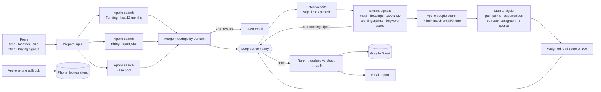

# AI Automation Lead Finder

**Describe your ideal customer in a form, and get back a ranked sheet of sales-ready leads.** Each lead comes with a decision maker, buying signals, an AI analysis and a drafted outreach message. Built with n8n, the Apollo.io API, OpenAI and Google Sheets.

`46 working nodes · 3 parallel company searches · 11 buying signals · 0–100 lead score`

## The pain point
Building a prospect list by hand takes hours per batch. You search a database, open every website, guess who the decision maker is, look up their contact details, and write an opener. The results are inconsistent, half the companies turn out to be dead or parked domains, the same company shows up twice, and "buying signals" usually means a gut feeling.

## What I built
One form submission runs the whole research pipeline:

## Design decisions that make the results trustworthy
| Problem | What I did |
|---|---|
| Wasted API credits on dead companies | Parked, expired, "coming soon" and near-empty sites are detected and skipped before any people search or LLM call |
| False signals from page markup | Keyword scans run on **cleaned text** (scripts, styles and comments stripped) with **word-boundary matching**, so "cro" doesn't match "across". Generic marketing phrases ("introducing", "case study") were removed from the signal lists |
| Signals that can't be scraped reliably | Funding and hiring use **Apollo's native filters** (funding in the last 12 months, ≥1 open job); the other 9 signals are text-detected |
| Companies with no website | Kept if they have a LinkedIn page, routed past the website fetch and still scored; companies with neither are dropped with a log line |
| LLM output breaking the pipeline | Strict JSON-only prompt; the parser strips code fences and trailing commas, and falls back to **neutral defaults** (3/5/3) instead of crashing |
| LLM deciding the score | The LLM gives three 1–10 inputs; the **final score is deterministic code** (see below) |
| Duplicate leads across runs | Leads are de-duplicated by normalised domain within the run **and** against rows already in the sheet, then capped at `Max_lead` |
| Silent empty runs | If Apollo returns nothing, an alert email includes the error, a truncated raw response and the available keys for debugging |
| Slow phone reveals | Apollo reveals phone numbers asynchronously; a separate webhook writes them into the `Phone_lookup` sheet when they arrive |

### Lead score (0–100)
| Component | Weight |
|---|---|
| Company size fit | 18% |
| Technology data available | 18% |
| Intent: LLM growth signal × 0.6 + detected buying signals × 0.4 | 17% |
| LLM automation need + AI readiness | 17% |
| Contact completeness (email, phone, title) | 18% |
| Funding stage / total funding | 12% |
| Bonuses: email +8, phone +5, revenue data +3, healthcare fit up to +5 (only on healthcare runs) | |

The weighted score is scaled by website content quality (thin pages count less).

## Run it yourself
1. Create a Google Sheet with tabs **Sheet1** and **Phone_lookup**, using the column layout in [`sample/`](sample/).
2. Import `workflows/lead-finder.json` into n8n.
3. Create the credentials listed in `.env.example` and attach them to the nodes marked with a warning.
4. Replace `YOUR_GOOGLE_SHEET_ID`, `https://YOUR-N8N-HOST` and `team@example.com`.
5. Activate the workflow, open the form URL, and start with `Max_lead = 3` to save Apollo credits.

See [`docs/DESIGN.md`](docs/DESIGN.md) for the signal lists and the LLM prompt.

## Known limitations
- The Apollo phone-callback webhook has no authentication yet; add a secret header check before production.
- Only the home page is fetched (sub-pages are detected as links but not crawled), and JavaScript-heavy sites may return little text.
- It drafts outreach but **doesn't send it**. That's deliberate, because a human should review every message.
- **Compliance:** revealing personal emails and phone numbers can fall under GDPR, CAN-SPAM, TCPA and India's DPDP Act. Make sure your use is lawful before running it at scale.
- No CRM sync; the sheet is the system of record.
